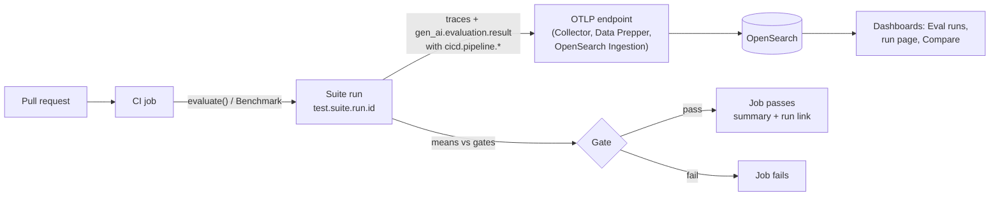

import { Aside, Tabs, TabItem } from '@astrojs/starlight/components';

An offline test suite is most useful when it runs on every change. In CI, each run of the suite becomes one **eval run** in OpenSearch Dashboards, linked back to the CI job that produced it, and the job fails when a score drops below its bar.

This page assumes you have a suite that runs locally. If not, start with the [Quickstart](/docs/agent-evals/quickstart/).

## How it fits together



## The GitHub Action example

The Python SDK ships a reusable composite action in [`examples/github-action`](https://github.com/opensearch-project/genai-observability-sdk-py/tree/main/examples/github-action). It installs the SDK, calls `register()` with your endpoints, runs your suite, writes a job summary (a link to the run in Dashboards and a table of per-evaluation means, pass and fail counts, and errored cases) and applies your gates.

### 1. Expose the suite as a function

A suite is a function with no arguments that calls `evaluate()` and returns its result (or a list of results). The action calls `register()` before it imports the file, so `@observe` spans and evaluation events go to the configured endpoints. The example runs the real agent from [The agent under test](/docs/agent-evals/evaluation-integrations/#the-agent-under-test) (`my_agent.py`, whose `ask()` returns the answer with its trace ids) and names each run after the pull request and commit.

```python
# evals/suite.py: the suite the GitHub Action runs (it calls register() before importing this file)
import os

from my_agent import AGENT_NAME, AGENT_VERSION, ask
from opensearch_genai_observability_sdk_py import evaluate, scorer

CASES = [
    {"case_id": "opensearch", "case_name": "What is OpenSearch", "input": "What is OpenSearch?", "expected": "search"},
    {"case_id": "otlp", "case_name": "What OTLP does", "input": "What does OTLP do?", "expected": "telemetry"},
    {"case_id": "rag", "case_name": "How RAG works", "input": "How does RAG work?", "expected": "retriev"},
    {"case_id": "data-prepper", "case_name": "What Data Prepper is", "input": "What is Data Prepper?", "expected": "OpenSearch"},
]


@scorer(name="contains_expected", evaluator_type="code", description="The answer contains the expected term")
def contains_expected(input, output, expected) -> bool:
    return expected.lower() in output.answer.lower()


@scorer(name="response_length", threshold=500, direction="minimize", evaluator_type="code",
        description="At most 500 characters")
def response_length(input, output, expected) -> float:
    return float(len(output.answer))


def suite():
    pr, sha = os.environ.get("PR_NUMBER", "main"), os.environ.get("GITHUB_SHA", "local")[:7]
    return evaluate(
        name="my-agent-suite",
        task=ask,
        data=CASES,
        scores=[contains_expected, response_length],
        agent_name=AGENT_NAME,
        agent_version=AGENT_VERSION,
        run_name=f"PR {pr} @ {sha}",
    )
```

### 2. Add the workflow

Copy [`example-workflow.yml`](https://github.com/opensearch-project/genai-observability-sdk-py/blob/main/examples/github-action/example-workflow.yml) to `.github/workflows/agent-evals.yml`. This version sends to two Amazon OpenSearch Ingestion pipelines (traces and logs) signed with SigV4:

```yaml
name: Agent evals

on:
  pull_request:
  workflow_dispatch:

permissions:
  contents: read
  id-token: write # OIDC for aws-actions/configure-aws-credentials

jobs:
  evals:
    runs-on: ubuntu-latest
    env:
      PR_NUMBER: ${{ github.event.pull_request.number || 'main' }} # used in the run name
    steps:
      - uses: actions/checkout@v6
      - uses: actions/setup-python@v6
        with:
          python-version: "3.12"

      - name: Install your agent
        run: python -m pip install -e .

      - name: AWS credentials for OpenSearch Ingestion
        uses: aws-actions/configure-aws-credentials@v6
        with:
          role-to-assume: ${{ secrets.EVALS_ROLE_ARN }}
          aws-region: us-east-1

      - name: Run evals
        id: evals
        # Pin to a commit SHA of the SDK repository in real use.
        uses: opensearch-project/genai-observability-sdk-py/examples/github-action@main
        with:
          suite: evals/suite.py:suite
          traces-endpoint: ${{ secrets.OSIS_TRACES_ENDPOINT }} # https://<traces-pipeline>/v1/traces
          logs-endpoint: ${{ secrets.OSIS_LOGS_ENDPOINT }}     # https://<logs-pipeline>/v1/logs
          aws-region: us-east-1
          aws-service: osis
          service-name: my-agent-ci
          dashboards-url: ${{ vars.OPENSEARCH_DASHBOARDS_URL }}
          fail-on-regression: |
            contains_expected=0.75
            response_length<=500

      - name: Print run link
        if: always()
        env:
          RUN_URL: ${{ steps.evals.outputs.run-url }}
        run: echo "Evaluation run: $RUN_URL"
```

For an OTel Collector, a Data Prepper `otlp` source or one OpenSearch Ingestion pipeline with both paths, pass a single OTLP base URL as `endpoint` instead and leave `aws-region` empty (unless the endpoint needs SigV4). Store the URLs as secrets or variables. Give the job's role `osis:Ingest` on the pipelines.

<Aside type="note">
The action needs an SDK release with the evaluation APIs used on this page. Until that release is on PyPI, set the action's `install` input to a git requirement pinned to a commit, for example `git+https://github.com/opensearch-project/genai-observability-sdk-py@<commit-sha>`.
</Aside>

### Inputs

| Input | Default | Description |
|---|---|---|
| `suite` | (required) | `module:function` or `path/to/file.py:function` |
| `endpoint` | | OTLP base URL for traces and logs |
| `traces-endpoint` / `logs-endpoint` | | Full OTLP URLs, one per signal. Always together |
| `aws-region` | | Signs both exporters with SigV4 when set |
| `aws-service` | `osis` | SigV4 service: `osis` or `es` |
| `service-name` | `agent-evals-ci` | `service.name` of the CI process |
| `dashboards-url` | | OpenSearch Dashboards base URL, for the run link. With workspaces, include `/w/<workspaceId>` |
| `fail-on-regression` | | Gates, see below |
| `pass-threshold` | `0.5` | Fallback for scores without a verdict, for the summary table only |
| `working-directory` | `.` | Directory to run the suite from |
| `install` | the SDK | pip requirement(s) installed first |

Outputs: `run-id` (the `test.suite.run.id`) and `run-url` (the run page in Dashboards). The run shows up in Dashboards once Data Prepper has written it, usually 60 to 90 seconds after the job sent it, so the link can open an empty run page for the first minute.

## Threshold gates

There are two kinds of thresholds, and they do different jobs:

- **Per result**, in the scorer: `@scorer(threshold=4, direction="maximize")` (or a `bool` / `pass` / `fail` label) decides each result's verdict. The verdict is stored on the result (`gen_ai.evaluation.score.label`) and drives the pass rates in Dashboards.
- **Per run**, in CI: `fail-on-regression` fails the job when an evaluation's **mean** over the run misses its bar.

The job's gate result is not stored on the run. A run whose job failed on a mean looks all green in Dashboards when every per-result verdict passed. If Dashboards should show the failure, give the scorer a per-result threshold at the same bar.

`fail-on-regression` takes one gate per line or comma, keyed by evaluation name (`gen_ai.evaluation.name`):

| Gate | Meaning |
|---|---|
| `answer_quality=4` or `answer_quality>=4` | Mean at least 4 |
| `latency_s<=12` | Mean at most 12, for `direction="minimize"` scorers |

Exit codes:

- `0`: no case errored and every gate passed.
- `1`: a case errored (the task or a scorer raised), or a gate failed: the mean is outside the bar, the evaluation produced no scores, or an errored case has no value for it.
- `2`: a configuration error, for example a malformed `suite` or gate, or only one of `traces-endpoint` / `logs-endpoint`.

### Other CI systems and TypeScript

The gate is a few lines around the run's summary, so any CI system works: run the suite, compare means, exit non-zero.

<Tabs syncKey="sdk-lang">
<TabItem label="Python">

```python
import sys

result = suite()
s = result.summary
mean = s.scores["contains_expected"].avg
print(f"run {s.run_id}: contains_expected mean {mean:.2f}")
provider.force_flush()  # the provider register() returned
sys.exit(1 if s.error_count or mean < 0.75 else 0)
```

</TabItem>
<TabItem label="TypeScript">

```typescript
const summary = bench.close(); // Benchmark, or evaluate(...).summary
await provider.forceFlush();
const mean = summary.scores["contains_expected"]?.avg ?? 0;
console.log(`run ${summary.runId}: contains_expected mean ${mean.toFixed(2)}`);
process.exit(summary.errorCount > 0 || mean < 0.75 ? 1 : 0);
```

</TabItem>
</Tabs>

Flush before you exit, or the last results never leave the process.

## CI/CD attributes

Inside CI, the SDK stamps the OTel `cicd.pipeline.*` attributes on every evaluation result, from the job's environment, and `evaluate()` also stamps them on the agent root spans it starts (`Benchmark` only on results). Outside CI nothing is added.

| CI system | Detected by | `cicd.pipeline.name` | `cicd.pipeline.run.id` | `cicd.pipeline.run.url.full` |
|---|---|---|---|---|
| GitHub Actions | `GITHUB_ACTIONS=true` | `GITHUB_WORKFLOW` | `GITHUB_RUN_ID` | `$GITHUB_SERVER_URL/$GITHUB_REPOSITORY/actions/runs/$GITHUB_RUN_ID` |
| GitLab CI | `GITLAB_CI=true` | `CI_PIPELINE_NAME`, else `CI_PROJECT_PATH` | `CI_PIPELINE_ID` | `CI_PIPELINE_URL` |
| Jenkins | `JENKINS_URL` and `BUILD_ID` | `JOB_NAME` | `BUILD_ID` | `BUILD_URL` |

For another CI system, pass them yourself: `ci_pipeline={"cicd.pipeline.name": ..., "cicd.pipeline.run.id": ..., "cicd.pipeline.run.url.full": ...}` to `evaluate()` or `Benchmark()` (`ciPipeline` in TypeScript).

In Dashboards, the run page header links to the CI run, and the result flyout shows the CI run of that result. Give each CI run a readable name too, for example `run_name=f"PR {pr_number} @ {sha[:7]}"`, so the Eval runs list reads like your CI history.

## Compare runs

Every run of a suite can be compared case by case with any other run of the same suite. Cases are matched by `test.case.id`, so keep case ids stable (see [Case identity](/docs/agent-evals/data-model/#case-identity)).

- From **Eval runs**, open a run and choose **Compare with run before**, or **Compare with…** to pick another run of the suite.
- Or link straight to the comparison, for example from the job summary: `<dashboards>/app/agentTraces/evaluations#/compare/<runA>/<runB>`. Run A is the baseline. URL-encode both ids; with workspaces, prefix `/w/<workspaceId>`.
- The run page itself: `<dashboards>/app/agentTraces/evaluations#/runs/<runId>`. `evaluate()` returns the id as `result.summary.run_id`.

Compare shows, per case, the status in each run (**Fixed**, **Regressed**, **Same**, or **Only in A** / **Only in B**), the per-evaluation change, and **Compare traces**, which puts both agent traces of a case on one timeline. Run A is the baseline; **Swap A and B** reverses it.

A good baseline for pull requests is the latest run on your main branch. Run the suite on `main` after each merge, save its `run-id` output (for example as a build artifact), and link `#/compare/<main run>/<PR run>` in the PR's job summary.

## Shard a suite under one run id

A large suite can run in parallel jobs and still report as one run: pass the same `run_id` from every shard, and give each shard a disjoint slice of the cases. Results with the same `test.suite.run.id` form one run, whichever process sent them.

<Tabs syncKey="sdk-lang">
<TabItem label="Python">

```python
import os

from opensearch_genai_observability_sdk_py import evaluate

shard = int(os.environ["SHARD_INDEX"])   # 0 .. SHARD_COUNT-1
count = int(os.environ["SHARD_COUNT"])
run_id = f"my-agent-suite-{os.environ['GITHUB_RUN_ID']}-{os.environ.get('GITHUB_RUN_ATTEMPT', '1')}"

result = evaluate(
    name="my-agent-suite",
    task=agent,
    data=[c for i, c in enumerate(cases) if i % count == shard],
    scores=[contains_expected],
    run_id=run_id,          # the same in every shard
    run_name=f"PR {os.environ.get('PR_NUMBER', 'main')}",
)
```

</TabItem>
<TabItem label="TypeScript">

```typescript
const shard = Number(process.env.SHARD_INDEX);
const count = Number(process.env.SHARD_COUNT);
const runId = `my-agent-suite-${process.env.GITHUB_RUN_ID}-${process.env.GITHUB_RUN_ATTEMPT ?? "1"}`;

const bench = new Benchmark("my-agent-suite", { runId, runName: `PR ${process.env.PR_NUMBER ?? "main"}` });
for (const c of cases.filter((_, i) => i % count === shard)) {
  // run the case, then bench.log({ caseId: c.caseId, input: c.input, output, expected: c.expected, traceId, spanId, scores })
}
bench.close();
```

</TabItem>
</Tabs>

With a GitHub Actions matrix:

```yaml
    strategy:
      matrix:
        shard: [0, 1, 2, 3]
    env:
      SHARD_INDEX: ${{ matrix.shard }}
      SHARD_COUNT: 4
```

- Include the run attempt in the id, so a re-run of the workflow is a new run instead of adding results to the old one.
- Each shard gates only its own cases. To gate on the whole run, add a final job that waits for the shards and reads the run from OpenSearch, or gate per shard with the same bars.
- Sending results with an existing run id adds them to that run; earlier results stay. Don't reuse a run id across different versions of the agent.

## Related

- [Data Model & Ingestion](/docs/agent-evals/data-model/): the `test.*` and `cicd.*` attributes and how they are indexed.
- [Evaluation & Scoring](/docs/agent-evals/evaluation/): scorers, verdicts and judges.
- [AWS Managed Services](/docs/deploy/aws/): an OpenSearch Ingestion endpoint for CI to send to.
