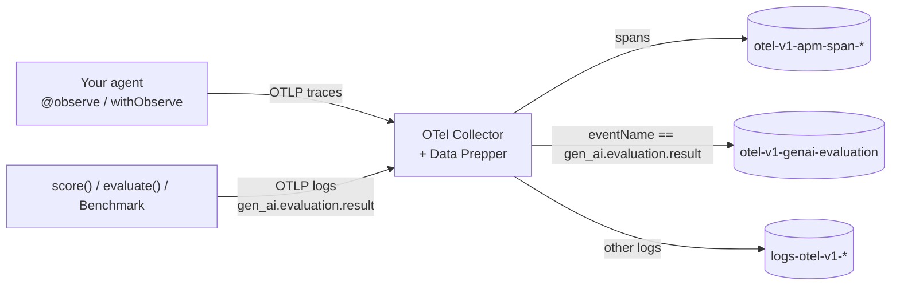

**Agent Evals** tell you whether your AI agents do a good job. A trace shows what an agent did. An evaluation puts a verdict on it: was the answer correct, grounded, safe and on task. You can track that per agent version, compare test runs, and catch regressions before and after a release.

In the Observability Stack, agent evaluations are three parts:

- **The SDK** ([Python](/docs/send-data/ai-agents/python/) or [TypeScript](/docs/send-data/ai-agents/typescript/)) records each score as one OpenTelemetry `gen_ai.evaluation.result` log event, linked to the trace it judged.
- **The pipeline** (Data Prepper, or Amazon OpenSearch Ingestion on AWS) routes those events, and only those, to their own index.
- **The evaluation index**, `otel-v1-genai-evaluation`, stores the results with a template that maps every evaluation field. Query it with PPL or the search API, and join it to the agent spans on `traceId` and `spanId`.



## Two ways to evaluate

- **Offline**: run a **test suite** on purpose, before a release or in CI. Each execution is a **run**, with one result per case per evaluator. SDK: `evaluate()` and `Benchmark`.
- **Online**: sample real traffic, score it, and attach the results to those traces or sessions. SDK: `score()`.

## The data model

```text
Test suite  "travel-planner-golden"                 test.suite.name
 └─ Run      run_20261105_215438_5df57445           test.suite.run.id  (one execution of the suite)
     └─ Case  "Plan a trip to Lisbon"               test.case.id / test.case.name
         ├─ Input      "Plan 3 days in Lisbon under $1,000"   → the agent's trace
         ├─ Expected   "Itinerary with flights + hotel ≤ $1,000"  → opensearch.test.case.expected
         ├─ Output     the agent's actual answer                  → the agent's trace
         └─ Evaluators run on (input, output, expected, trace):
              ├─ answer_quality   score 4/5, pass   → 1 result event
              ├─ budget_respected pass               → 1 result event
              └─ safety           pass               → 1 result event
```

Online results have no suite, run or case. See [Data Model & Ingestion](/docs/agent-evals/data-model/) for every attribute.

## Core concepts

| Term | Meaning |
|---|---|
| **Evaluation** | What is measured, for example `answer_quality` (`gen_ai.evaluation.name`). Results are grouped by it. |
| **Evaluator** | What produces the result: a code check, an LLM judge, a human, or an external tool (`opensearch.gen_ai.evaluation.evaluator.*`). |
| **Result** | One `gen_ai.evaluation.result` event: a score, a label, an explanation, and the span, trace or session it judged. |
| **Verdict** | `pass` or `fail` in `gen_ai.evaluation.score.label`. Your evaluator or its threshold decides it. A result without a verdict is only scored. |
| **Test suite, run, case** | The offline structure above. Cases are matched across runs by `test.suite.name` and `test.case.id`. |

## SDK versions

Agent evaluations need the Python SDK 0.3.0 or the TypeScript SDK 0.2.0, or later:

```bash
pip install "opensearch-genai-observability-sdk-py>=0.3.0"
npm install @opensearch-project/genai-observability-sdk-ts@^0.2.0
```

## In this section

- **[Quickstart](/docs/agent-evals/quickstart/)**: start the stack, install the SDK, send offline and online results, and query them.
- **[Evaluation & Scoring](/docs/agent-evals/evaluation/)**: `score()`, `evaluate()` and `Benchmark` in Python and TypeScript, pass rules, LLM judges, scorer ownership and result keys.
- **[Run evaluations in CI](/docs/agent-evals/ci/)**: the SDK GitHub Action, threshold gates, `cicd.pipeline.*` attributes, and sharding.
- **[Data Model & Ingestion](/docs/agent-evals/data-model/)**: the event, the attributes, the index template, the ISM policy, and pipeline routing.
- **[Evaluation Integrations](/docs/agent-evals/evaluation-integrations/)**: keep DeepEval, RAGAS, MLflow or pytest and send their results.
- **[Example Agents](/docs/ai-observability/examples/)**: the travel planner and the two eval canaries that run with the stack.

## SDK documentation

The SDK repositories hold the full reference. These pages link to them instead of repeating them:

| | Python | TypeScript |
|---|---|---|
| Getting started with evaluations | [getting-started-evaluations.md](https://github.com/opensearch-project/genai-observability-sdk-py/blob/main/docs/getting-started-evaluations.md) | [getting-started-evaluations.md](https://github.com/opensearch-project/genai-observability-sdk-ts/blob/main/docs/getting-started-evaluations.md) |
| Agent evaluations guide | [agent-evaluations.md](https://github.com/opensearch-project/genai-observability-sdk-py/blob/main/docs/agent-evaluations.md) | [agent-evaluations.md](https://github.com/opensearch-project/genai-observability-sdk-ts/blob/main/docs/agent-evaluations.md) |
| API reference | [api-reference.md](https://github.com/opensearch-project/genai-observability-sdk-py/blob/main/docs/api-reference.md) | [api-reference.md](https://github.com/opensearch-project/genai-observability-sdk-ts/blob/main/docs/api-reference.md) |
| GitHub Action | [examples/github-action](https://github.com/opensearch-project/genai-observability-sdk-py/tree/main/examples/github-action) | |

## Related

- [Agent Observability](/docs/ai-observability/): trace and visualize agent execution, the data your evals judge.
- [Send Data: AI Agents](/docs/send-data/ai-agents/): instrument an agent so its traces, and its evals, reach the stack.
