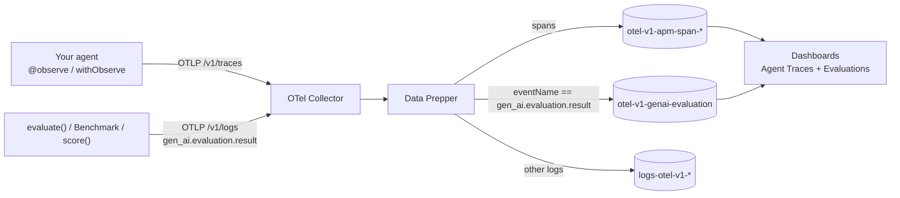

import { Aside, Steps, Tabs, TabItem, Code } from '@astrojs/starlight/components';
import codingAgentPrompt from '../../../snippets/coding-agent-prompt.md?raw';

This quickstart takes you from an empty stack to evaluation results in OpenSearch Dashboards. You run a small offline test suite against a real agent (a [Strands](/docs/send-data/ai-agents/integrations/#strands-agents) agent on Amazon Bedrock), score one live trace online, set up **Agent Evaluations** in Dashboards, open the run, then change the agent and compare the two runs.

<Aside type="caution" title="Preview">
Agent Evaluations needs:

- the Python SDK 0.3.0 or later, or the TypeScript SDK 0.2.0 or later (step 2). If an import such as `mark_agent_root` or `markAgentRoot` fails, upgrade.
- an OpenSearch Dashboards build with **Agent monitoring > Evaluations**, with `explore.agentTraces.enabled: true` and `explore.agentTraces.evaluations.enabled: true` in `opensearch_dashboards.yml`.
</Aside>

## What you build



Each score is one `gen_ai.evaluation.result` log event, linked to the agent trace it judged. The [Data Model & Ingestion](/docs/agent-evals/data-model/) page describes the event and the index in full.

## Prerequisites

- Docker with Docker Compose
- Python 3.10+ or Node.js 20+
- For the Python agent: AWS credentials (the default chain) with access to a Claude model on Amazon Bedrock. Any other Strands model provider works the same way. The TypeScript tab uses a mock agent and needs no model.

<Steps>

1. **Start the stack**

    ```bash
    git clone https://github.com/opensearch-project/observability-stack.git
    cd observability-stack
    docker compose up -d
    ```

    For evaluations, the stack:

    - routes `gen_ai.evaluation.result` events, and only those, from Data Prepper to the `otel-v1-genai-evaluation` write alias. All other logs still go to `logs-otel-v1-*`.
    - creates the evaluation index template, its ISM policy and the first index `otel-v1-genai-evaluation-000001`. See [The evaluation index](/docs/agent-evals/data-model/#the-evaluation-index).

    The OTel Collector listens on `4318` (OTLP/HTTP) and `4317` (gRPC), OpenSearch on `9200`, Dashboards on `5601`. The admin password is `OPENSEARCH_PASSWORD` in `.env`.

    To use your own Data Prepper or an AWS deployment instead, set up the route and the index from [Route results with Data Prepper](/docs/agent-evals/data-model/#route-results-with-data-prepper) or [AWS Managed Services](/docs/deploy/aws/#agent-evaluation-results).

2. **Install the SDK**

    <Tabs syncKey="sdk-lang">
    <TabItem label="Python">

    ```bash
    python -m venv .venv && source .venv/bin/activate
    pip install "opensearch-genai-observability-sdk-py>=0.3.0" strands-agents
    export OTEL_SEMCONV_STABILITY_OPT_IN=gen_ai_latest_experimental,gen_ai_span_attributes_only,gen_ai_use_latest_invocation_tokens
    ```

    </TabItem>
    <TabItem label="TypeScript">

    ```bash
    npm install "@opensearch-project/genai-observability-sdk-ts@>=0.2.0" @opentelemetry/api @opentelemetry/context-async-hooks
    ```

    Use ES modules (`"type": "module"` in `package.json`) and run the examples with `npx tsx`.

    </TabItem>
    </Tabs>

3. **Register once at startup**

    `register()` sets up two OTLP exporters: traces for the agent spans and logs for the evaluation events. With no endpoint it sends to `http://localhost:4318`, the stack's collector. `agent_name` and `agent_version` are stamped on every result, so the Evaluations pages can group by agent version.

    <Tabs syncKey="sdk-lang">
    <TabItem label="Python">

    ```python
    from opensearch_genai_observability_sdk_py import register

    provider = register(
        service_name="quickstart-agent",
        agent_name="quickstart_agent",
        agent_version="v1",
    )
    ```

    </TabItem>
    <TabItem label="TypeScript">

    ```typescript
    import { context } from "@opentelemetry/api";
    import { AsyncLocalStorageContextManager } from "@opentelemetry/context-async-hooks";
    import { register } from "@opensearch-project/genai-observability-sdk-ts";

    // Async code keeps the active span only with a context manager.
    context.setGlobalContextManager(new AsyncLocalStorageContextManager().enable());

    const provider = await register({
      serviceName: "quickstart-agent",
      agentName: "quickstart_agent",
      agentVersion: "v1",
    });
    ```

    </TabItem>
    </Tabs>

    For another collector, Data Prepper or Amazon OpenSearch Ingestion, pass `endpoint=` (an OTLP base URL, no `/v1/traces`), or `traces_endpoint=` and `logs_endpoint=` together, plus `sigv4=` for OpenSearch Ingestion. See the [Python](/docs/send-data/ai-agents/python/#register) and [TypeScript](/docs/send-data/ai-agents/typescript/#register) SDK pages.

4. **Run an offline test suite**

    A test suite is data, scorers are functions, and one `evaluate()` call is one run. Save this as `quickstart_evals.py` (or `quickstart_evals.ts`). The Python agent answers four questions with the `v1` prompt "Answer in as few words as possible.", so a one-word answer can fail `answer_length`. The TypeScript mock agent answers from a table, and its last case fails on purpose.

    <Tabs syncKey="sdk-lang">
    <TabItem label="Python">

    ```python
    """Agent evaluations quickstart: a Strands agent on Amazon Bedrock, two scorers, one offline run.

    pip install "opensearch-genai-observability-sdk-py>=0.3.0" strands-agents
    export OTEL_SEMCONV_STABILITY_OPT_IN=gen_ai_latest_experimental,gen_ai_span_attributes_only,gen_ai_use_latest_invocation_tokens
    """
    import os

    from strands import Agent
    from strands.models.bedrock import BedrockModel

    from opensearch_genai_observability_sdk_py import Op, enrich, evaluate, mark_agent_root, observe, register, scorer

    AGENT_NAME = "quickstart_agent"
    AGENT_VERSION = os.environ.get("AGENT_VERSION", "v1")
    PROMPTS = {"v1": "Answer in as few words as possible.", "v2": "Answer in one complete sentence."}

    provider = register(service_name="quickstart-agent", agent_name=AGENT_NAME, agent_version=AGENT_VERSION)


    def text(role: str, content: str) -> list[dict]:
        return [{"role": role, "parts": [{"type": "text", "content": content}]}]


    @observe(name=AGENT_NAME, op=Op.INVOKE_AGENT)
    def agent(question: str) -> str:
        mark_agent_root()  # this span is the agent run in Agent Traces
        enrich(input_messages=text("user", question), **{"gen_ai.agent.version": AGENT_VERSION})
        model = BedrockModel(model_id="us.anthropic.claude-haiku-4-5-20251001-v1:0", region_name="us-west-2")
        answer = str(Agent(name=AGENT_NAME, model=model, system_prompt=PROMPTS[AGENT_VERSION],
                           callback_handler=None)(question)).strip()
        enrich(output_messages=text("assistant", answer))
        return answer


    @scorer(name="contains_expected", evaluator_type="code", description="The answer contains the expected text")
    def contains_expected(input, output, expected) -> bool:
        return expected.lower() in output.lower()  # a bool is a pass / fail verdict


    @scorer(name="answer_length", threshold=0.5, score_min=0, score_max=1, evaluator_type="code",
            description="The answer is a sentence, not a single word")
    def answer_length(input, output, expected) -> float:
        return min(len(output) / 40.0, 1.0)  # passes at 20 characters or more


    result = evaluate(
        name="quickstart-suite",  # test.suite.name, stable across runs
        task=agent,
        data=[
            {"case_id": "opensearch", "case_name": "What is OpenSearch", "input": "What is OpenSearch?", "expected": "search"},
            {"case_id": "otlp", "case_name": "OTLP acronym", "input": "What does OTLP stand for?", "expected": "OpenTelemetry"},
            {"case_id": "france", "case_name": "Capital of France", "input": "Capital of France?", "expected": "Paris"},
            {"case_id": "hamlet", "case_name": "Author of Hamlet", "input": "Who wrote Hamlet?", "expected": "Shakespeare"},
        ],
        scores=[contains_expected, answer_length],
        run_name=f"{AGENT_VERSION} {PROMPTS[AGENT_VERSION].lower().rstrip('.')}",
    )
    print("run id:", result.summary.run_id)
    provider.force_flush()  # export spans and evaluation events before exit
    ```

    </TabItem>
    <TabItem label="TypeScript">

    ```typescript
    import { context } from "@opentelemetry/api";
    import { AsyncLocalStorageContextManager } from "@opentelemetry/context-async-hooks";
    import { Op, defineScorer, evaluate, markAgentRoot, observe, register } from "@opensearch-project/genai-observability-sdk-ts";

    context.setGlobalContextManager(new AsyncLocalStorageContextManager().enable());
    const provider = await register({ serviceName: "quickstart-agent", agentName: "quickstart_agent", agentVersion: "v1" });

    const ANSWERS: Record<string, string> = {
      "What is OpenSearch?": "OpenSearch is an open source search and analytics suite.",
      "What does OTLP stand for?": "OpenTelemetry Protocol.",
      "Capital of France?": "Paris is the capital of France.",
      "Who wrote Hamlet?": "I am not sure.",
    };

    // evaluate() needs a synchronous task; for async agents use Benchmark (see Evaluation & Scoring).
    const agent = observe({ name: "quickstart_agent", op: Op.INVOKE_AGENT }, (question: string) => {
      markAgentRoot();
      return ANSWERS[question] ?? "I don't know.";
    });

    const containsExpected = defineScorer(
      { name: "contains_expected", evaluatorType: "code", evaluatorDescription: "The answer contains the expected text" },
      (_input, output, expected) => String(output).toLowerCase().includes(String(expected).toLowerCase()),
    );
    const answerLength = defineScorer(
      { name: "answer_length", threshold: 0.5, scoreMin: 0, scoreMax: 1, evaluatorType: "code" },
      (_input, output) => Math.min(String(output).length / 40, 1),
    );

    const result = evaluate({
      name: "quickstart-suite",
      task: (input) => agent(String(input)),
      data: [
        { caseId: "opensearch", caseName: "What is OpenSearch", input: "What is OpenSearch?", expected: "search" },
        { caseId: "otlp", caseName: "OTLP acronym", input: "What does OTLP stand for?", expected: "OpenTelemetry" },
        { caseId: "france", caseName: "Capital of France", input: "Capital of France?", expected: "Paris" },
        { caseId: "hamlet", caseName: "Author of Hamlet", input: "Who wrote Hamlet?", expected: "Shakespeare" },
      ],
      scores: [containsExpected, answerLength],
      runName: "v1 baseline",
    });
    console.log("run id:", result.summary.runId);
    await provider.forceFlush();
    ```

    </TabItem>
    </Tabs>

    Run it (`python quickstart_evals.py`, or `npx tsx quickstart_evals.ts`). `evaluate()` prints a summary with the run id. The run sends:

    - 4 agent traces (`invoke_agent quickstart_agent`). Each root span carries `test.suite.name`, `test.suite.run.id` and `test.case.id`.
    - 8 `gen_ai.evaluation.result` events, one per case per scorer, each parented to its case's agent root span, with the expected output in `opensearch.test.case.expected`. With the Python agent, `france` usually answers "Paris." and fails `answer_length`; with the TypeScript mock, `hamlet` fails both scorers.

    Keep `case_id` stable: Compare matches cases by it. Without one, the SDK derives the id from a hash of the input, so editing a question makes a new case.

5. **Score live traffic online**

    Online results have no suite or run: they judge real traces. The simplest form is `score()` while the agent span is active; the result joins that span. Later, an evaluator job can score stored traces by id (`trace_id=`, `span_id=`), as shown in [Evaluation & Scoring](/docs/agent-evals/evaluation/#online-evaluation-score).

    <Tabs syncKey="sdk-lang">
    <TabItem label="Python">

    ```python
    """Score live traffic online: the result joins the active agent span."""
    from strands import Agent
    from strands.models.bedrock import BedrockModel

    from opensearch_genai_observability_sdk_py import Op, enrich, mark_agent_root, observe, register, score

    AGENT_NAME, AGENT_VERSION = "quickstart_agent", "v2"
    provider = register(service_name="quickstart-agent", agent_name=AGENT_NAME, agent_version=AGENT_VERSION)


    def text(role: str, content: str) -> list[dict]:
        return [{"role": role, "parts": [{"type": "text", "content": content}]}]


    @observe(name=AGENT_NAME, op=Op.INVOKE_AGENT)
    def agent(question: str) -> str:
        mark_agent_root()
        enrich(input_messages=text("user", question), **{"gen_ai.agent.version": AGENT_VERSION})
        model = BedrockModel(model_id="us.anthropic.claude-haiku-4-5-20251001-v1:0", region_name="us-west-2")
        answer = str(Agent(name=AGENT_NAME, model=model, system_prompt="Answer in one complete sentence.",
                           callback_handler=None)(question)).strip()
        enrich(output_messages=text("assistant", answer))
        score(  # inline: the active span (this agent run) is judged
            "answer_mentions_city",
            1.0 if "Paris" in answer else 0.0,
            threshold=1,
            evaluator="city_check",
            evaluator_type="code",
        )
        return answer


    print(agent("What is the capital of France?"))
    provider.force_flush()
    ```

    </TabItem>
    <TabItem label="TypeScript">

    ```typescript
    import { context } from "@opentelemetry/api";
    import { AsyncLocalStorageContextManager } from "@opentelemetry/context-async-hooks";
    import { Op, markAgentRoot, register, score, withObserve } from "@opensearch-project/genai-observability-sdk-ts";

    // Without a context manager, score() cannot see the active span and the result is not linked to the trace.
    context.setGlobalContextManager(new AsyncLocalStorageContextManager().enable());
    const provider = await register({ serviceName: "quickstart-agent", agentName: "quickstart_agent", agentVersion: "v1" });

    await withObserve("quickstart_agent", { op: Op.INVOKE_AGENT }, async () => {
      markAgentRoot();
      const answer = "Paris is the capital of France.";
      score({
        name: "answer_mentions_city",
        value: answer.includes("Paris") ? 1 : 0,
        threshold: 1,
        evaluator: "city_check",
        evaluatorType: "code",
      });
      return answer;
    });
    await provider.forceFlush();
    ```

    </TabItem>
    </Tabs>

6. **Check that the results arrived** (optional)

    Data Prepper batches writes, so results usually show up within 60 to 90 seconds:

    ```bash
    curl -sk -u "admin:$OPENSEARCH_PASSWORD" \
      'https://localhost:9200/otel-v1-genai-evaluation/_search?size=0' \
      -H 'Content-Type: application/json' \
      -d '{"query":{"term":{"attributes.gen_ai.agent.name":"quickstart_agent"}},"aggs":{"runs":{"terms":{"field":"attributes.test.suite.run.id","missing":"(online)"}}}}'
    ```

    You see one bucket per run with 8 results each (one run per language you ran) and an `(online)` bucket with 1 per online run. If the results are in `logs-otel-v1-*` instead, the route is missing: see [Route results with Data Prepper](/docs/agent-evals/data-model/#route-results-with-data-prepper).

7. **Set up Agent Evaluations in Dashboards**

    Open [http://localhost:5601](http://localhost:5601), sign in as `admin`, and go to **Agent monitoring > Evaluations**. The first time, the page offers **Set up evaluations**. The setup has four steps:

    1. **Overview**: what Agent Evaluations shows.
    2. **Evaluation results**: it detects the results, for example "Found 9 evaluation results in otel-v1-genai-evaluation*". If nothing is found yet, you can still finish: the pages fill in as results arrive.
    3. **Agent traces**: pick the traces dataset the results judge (the stack's `otel-v1-apm-span*`).
    4. **Create**: it creates the evaluations dataset (a logs dataset over `otel-v1-genai-evaluation*` with time field `@timestamp`) and saves the Agent Evaluations config of the workspace. Select **Create and open**.

    You can change both datasets later with **Settings** in the page header.

8. **See your results**

    The time range defaults to a recent window; widen it if your run is older.

    - **Agents** (home): one row per agent, with the pass rate per agent version. `quickstart_agent` `v1` shows the suite's results; the Python online example records version `v2`, so its result shows under `v2`.
    - **Eval runs**: one row per run. The Python run `v1 answer in as few words as possible` of `quickstart-suite` typically has 3 of 4 cases passing (the TypeScript run is `v1 baseline`).
    - **Run page**: select the run to see its cases. Expand a case (for example `france`) to see the agent's input and output, the expected output, each evaluator's result, and **View trace**, which opens the agent trace in Agent Traces. Inside CI, the run header also links to the CI run.
    - **Eval results**: every result in the range. Select one to open the result flyout: score, verdict, explanation, evaluator, what the judge saw (the judged span's input and output), and the judge's own trace when recorded.
    - **Agent Traces**: traces with results show them in the **Evaluations** column and in the **Evaluations** tab of the trace flyout.

9. **Run again and compare**

    Python: run the suite again with the `v2` prompt ("Answer in one complete sentence."):

    ```bash
    AGENT_VERSION=v2 python quickstart_evals.py
    ```

    Open the new run (`v2 answer in one complete sentence`) from **Eval runs** and choose **Compare with run before**: in the tested run `france` showed as **Fixed** (it now answers in a sentence) and no case as **Regressed**. A real model's answers vary, so your cases can differ. Compare matches cases by `test.case.id`; run A is the baseline.

    TypeScript: change the mock answer to `"Who wrote Hamlet?"` to `"William Shakespeare wrote Hamlet."`, set `agentVersion: "v2"` and `runName: "v2 fixed hamlet"`, and run the suite again: `hamlet` shows as **Fixed**.

</Steps>

## Prompt for your coding agent

Paste this into your coding agent, in your agent's repository, to instrument it and add evaluations the same way:

<Code code={codingAgentPrompt} lang="markdown" title="Prompt for your coding agent" />

## Next steps

- [Evaluation & Scoring](/docs/agent-evals/evaluation/): every option of `score()`, `evaluate()` and `Benchmark`, LLM judges and verdict rules.
- [Run evaluations in CI](/docs/agent-evals/ci/): run the suite on every pull request and fail on regressions.
- [Data Model & Ingestion](/docs/agent-evals/data-model/): every attribute, the index template, and Data Prepper routing.
- [Evaluation Integrations](/docs/agent-evals/evaluation-integrations/): keep DeepEval, RAGAS, MLflow or pytest and send their results.
