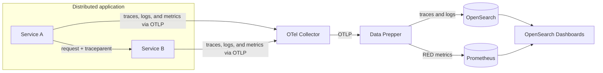

The OpenSearch Observability Stack is built on open standards with OpenTelemetry at its core. Every component is open-source and runs in Docker containers on your machine.

## Architecture

## Data flow

1. **Instrumentation**: Your applications send traces, logs, and metrics via OTLP to the OTel Collector.
2. **Collection**: The OTel Collector batches, processes, and routes data to downstream systems.
3. **Processing**: Data Prepper ingests trace data, builds service maps, and computes RED metrics (request rate, error rate, duration).
4. **Storage**: OpenSearch indexes traces and logs. Prometheus stores time-series metrics.
5. **Visualization**: OpenSearch Dashboards provides trace exploration, agent trace views, PromQL-based metric charts, and service maps.

## How an APM request appears in the stack

For a distributed application, a request normally follows this path:

The trace spans stored in OpenSearch provide the detail for a request and its
individual operations. Data Prepper also uses the propagated trace context to
derive service-to-service relationships and RED metrics. OpenSearch Dashboards
combines those results in the Services catalog and Application Map. If one of
these views is empty, use [Troubleshooting APM](/docs/apm/troubleshooting/) to
identify which boundary needs attention.

## Key design decisions

- **OpenTelemetry-native**: All data ingestion uses OTel protocols and semantic conventions. No proprietary agents.
- **GenAI semantic conventions**: AI agent traces use the standard `gen_ai.*` OTel attributes, enabling interoperability with any OTel-compatible tool.
- **PPL and PromQL**: Query traces and logs with PPL (Piped Processing Language) and metrics with PromQL.
- **Local-first**: The entire stack runs on your machine via Docker Compose. No cloud account or external dependencies required.
