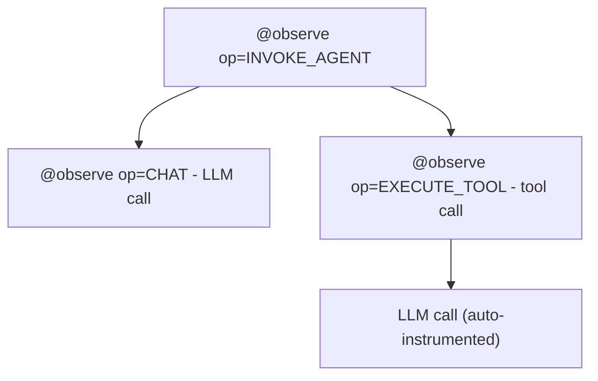

import { Aside, Code } from '@astrojs/starlight/components';
import codingAgentPrompt from '../../../../snippets/coding-agent-prompt.md?raw';

`opensearch-genai-observability-sdk-py` instruments Python AI agent applications using standard OpenTelemetry. It configures the OTEL pipeline in one call, provides a unified `observe()` primitive for tracing agents and tools, and enriches spans with GenAI semantic convention attributes automatically.

- **PyPI:** [`opensearch-genai-observability-sdk-py`](https://pypi.org/project/opensearch-genai-observability-sdk-py/)
- **Python:** 3.10+
- **Source:** [github.com/opensearch-project/genai-observability-sdk-py](https://github.com/opensearch-project/genai-observability-sdk-py)

## Installation

```bash
pip install opensearch-genai-observability-sdk-py
```

Auto-instrumentation for LLM providers is opt-in:

```bash
pip install "opensearch-genai-observability-sdk-py[openai]"
pip install "opensearch-genai-observability-sdk-py[anthropic]"
pip install "opensearch-genai-observability-sdk-py[bedrock]"
pip install "opensearch-genai-observability-sdk-py[google]"
pip install "opensearch-genai-observability-sdk-py[langchain]"
pip install "opensearch-genai-observability-sdk-py[llamaindex]"
pip install "opensearch-genai-observability-sdk-py[otel-instrumentors]"  # all providers
pip install "opensearch-genai-observability-sdk-py[opensearch]"          # trace retrieval
pip install "opensearch-genai-observability-sdk-py[all]"                 # SDK development: instrumentors + pytest, ruff, mypy, ...
```

Quote the extra: zsh treats unquoted brackets as a glob. An extra installs only the OpenTelemetry instrumentor, not the library it instruments: install that yourself (for example `boto3`, `anthropic[bedrock]`, `langgraph langchain-aws`, `llama-index-core llama-index-llms-bedrock-converse`). `[all]` is meant for SDK development and also installs pytest, ruff, mypy, bandit, safety and pre-commit; applications should use single extras or `[otel-instrumentors]`.

## API overview

The SDK exports these functions and classes. This page covers the instrumentation APIs. Evaluation APIs are documented in [Evaluation & Scoring](/docs/agent-evals/evaluation/).

| Export | Purpose | Docs |
|---|---|---|
| `register()` | Configure the OTLP traces and logs pipelines | [This page](#register) |
| `observe()` | Trace agents, tools, LLM calls | [This page](#observe) |
| `Op` | Operation name constants | [This page](#op-constants) |
| `enrich()` | Set GenAI attributes on the active span | [This page](#enrich) |
| `mark_agent_root()` | Mark the active span as the trace's agent root | [This page](#mark_agent_root) |
| `score()` | Record an evaluation result on a span, trace or session | [Evaluation & Scoring](/docs/agent-evals/evaluation/#online-evaluation-score) |
| `evaluate()`, `scorer`, `EvalScore` | Run an agent over a test suite with scorers | [Evaluation & Scoring](/docs/agent-evals/evaluation/#offline-evaluation-evaluate) |
| `Benchmark` | Log offline results for cases you ran yourself | [Evaluation & Scoring](/docs/agent-evals/evaluation/#offline-evaluation-benchmark) |
| `OpenSearchTraceRetriever` | Read stored traces back from OpenSearch | [Evaluation & Scoring](/docs/agent-evals/evaluation/#opensearchtraceretriever) |
| `AWSSigV4OTLPExporter`, `AWSSigV4OTLPLogExporter` | SigV4-signed OTLP exporters | [This page](#aws-authentication) |

## Quick start

```python
from opensearch_genai_observability_sdk_py import Op, enrich, mark_agent_root, observe, register

register(service_name="my-agent", agent_name="assistant")  # OTLP to http://localhost:4318

@observe(op=Op.EXECUTE_TOOL)
def get_weather(city: str) -> dict:
    return {"city": city, "temp": 22, "condition": "sunny"}

def _messages(role, text):
    return [{"role": role, "parts": [{"type": "text", "content": text}]}]

@observe(name="assistant", op=Op.INVOKE_AGENT)
def assistant(query: str) -> str:
    mark_agent_root()
    enrich(session_id="conversation-42", input_messages=_messages("user", query))
    data = get_weather("Paris")
    answer = f"{data['condition']}, {data['temp']}C"
    enrich(output_messages=_messages("assistant", answer))
    return answer

result = assistant("What's the weather?")
```

---

## `register()`

Configures two OTLP pipelines: traces (a `TracerProvider`) and logs (a `LoggerProvider`) for the `gen_ai.evaluation.result` events that `score()`, `evaluate()` and `Benchmark` emit. Call once at startup, before the agent or framework is built.

```python
from opensearch_genai_observability_sdk_py import register

provider = register(
    service_name="my-app",
    agent_name="travel_planner",  # gen_ai.agent.name on every evaluation result
    agent_version="v3",           # gen_ai.agent.version on every evaluation result
)
```

| Parameter | Default | Description |
|---|---|---|
| `endpoint` | resolved | OTLP **base** URL for both signals (like `OTEL_EXPORTER_OTLP_ENDPOINT`). Over HTTP the SDK appends `/v1/traces` and `/v1/logs`. A base ending in `/v1/traces` or `/v1/logs` raises `ValueError` |
| `traces_endpoint`, `logs_endpoint` | resolved | Full URLs, one per signal. Pass both or neither |
| `protocol` | from the URL | `"http"` or `"grpc"`. `grpc://` is insecure gRPC, `grpcs://` gRPC with TLS |
| `compression` | `none` | `"none"` or `"gzip"`; must match the receiving pipeline |
| `headers` | `OTEL_EXPORTER_OTLP_HEADERS` | Extra headers for both exporters |
| `sigv4` | `None` | `True` or `{"service": "osis", "region": ...}`: sign both exporters with SigV4 |
| `service_name` | `OTEL_SERVICE_NAME` | `service.name` |
| `service_version` | `OTEL_SERVICE_VERSION` | `service.version` |
| `agent_name`, `agent_version` | `None` | Default agent for evaluation results |
| `batch` | `True` | Batch or simple span and log processors |
| `auto_instrument` | `True` | Discover and activate installed instrumentor packages |
| `exporter`, `log_exporter` | `None` | Custom exporters, used as-is |
| `enable_logs` | `True` | Set up the logs pipeline for evaluation events |
| `set_global` | `True` | Register as the global providers |

Returns the `TracerProvider`. Its `force_flush()` and `shutdown()` also flush the logs pipeline, so call `provider.force_flush()` before a script exits.

### Endpoint resolution

Per signal, the first that is set wins: `traces_endpoint=` / `logs_endpoint=`, then `endpoint=`, then `OTEL_EXPORTER_OTLP_TRACES_ENDPOINT` / `OTEL_EXPORTER_OTLP_LOGS_ENDPOINT`, then `OTEL_EXPORTER_OTLP_ENDPOINT`, then `http://localhost:4318`.

<Aside type="caution" title="Upgrading from earlier releases">
`endpoint=` used to be the full traces URL; it is now the OTLP base URL, and the default moved from `http://localhost:21890/opentelemetry` to `http://localhost:4318`. Remove a `/v1/traces` suffix, or pass `traces_endpoint=` and `logs_endpoint=`.
</Aside>

### Examples

```python
# Local OTel Collector or the observability stack: nothing to set
register(service_name="my-agent")

# gRPC to a collector
register(endpoint="grpc://localhost:4317", service_name="my-agent")

# One Data Prepper or OpenSearch Ingestion otlp source for both signals, under a pipeline path
register(endpoint="https://<host>/<pipeline>", sigv4={"service": "osis", "region": "us-east-1"})

# Separate traces and logs pipelines (OpenSearch Ingestion, SigV4)
register(
    traces_endpoint="https://<traces-pipeline>.us-east-1.osis.amazonaws.com/v1/traces",
    logs_endpoint="https://<logs-pipeline>.us-east-1.osis.amazonaws.com/v1/logs",
    sigv4=True,
    service_name="my-agent",
)
```

Evaluation results travel as OTLP **logs**, so the logs path must reach Data Prepper too. Do not call a framework's own exporter setup as well (for example `StrandsTelemetry().setup_otlp_exporter()`): `register()` owns the global tracer provider.

---

## `observe()`

The unified tracing primitive. Works as a **decorator** (sync, async, generator, async generator) and as a **context manager**.

### Usage forms

```python
# Bare decorator - span name = function qualname
@observe
def my_function():
    ...

# Parameterized - set operation type, name, span kind
@observe(name="weather_agent", op=Op.INVOKE_AGENT)
def run_agent(query: str) -> str:
    ...

# Context manager - for inline tracing blocks
with observe("llm_call", op=Op.CHAT) as span:
    response = llm.chat(messages)
```

### Parameters

| Parameter | Type | Default | Description |
|---|---|---|---|
| `name` | `str` | function `__qualname__` | Span entity name. |
| `op` | `str` | | Sets `gen_ai.operation.name`. Span name becomes `"{op} {name}"`. |
| `kind` | `SpanKind` | `INTERNAL` | OTel `SpanKind`. |
| `name_from` | `str` | | Function parameter whose runtime value becomes the span name. |

### `Op` constants

| Constant | Value | Use for |
|---|---|---|
| `Op.INVOKE_AGENT` | `"invoke_agent"` | Agent invocations and orchestration |
| `Op.EXECUTE_TOOL` | `"execute_tool"` | Tool/function calls |
| `Op.CHAT` | `"chat"` | LLM chat completions |
| `Op.CREATE_AGENT` | `"create_agent"` | Agent initialization |
| `Op.RETRIEVAL` | `"retrieval"` | RAG retrieval |
| `Op.EMBEDDINGS` | `"embeddings"` | Embedding generation |
| `Op.GENERATE_CONTENT` | `"generate_content"` | Content generation |
| `Op.TEXT_COMPLETION` | `"text_completion"` | Text completions |

Any custom string also works for `op`.

### Automatic behavior

In decorator mode, `observe()` automatically:

- **Captures input** as `gen_ai.input.messages` (or `gen_ai.tool.call.arguments` for tools), as a JSON object of the function's arguments (for example `{"question": "..."}`), not GenAI chat messages. Skips `self`/`cls`. For the agent span, set `input_messages` / `output_messages` with `enrich()` in the GenAI format so Agent Traces and online evaluators can read them; `enrich()` values replace the captured ones.
- **Captures output** as `gen_ai.output.messages` (or `gen_ai.tool.call.result` for tools). Won't overwrite if already set.
- **Records errors** as span status `ERROR` with an exception event.
- **Sets entity attributes** - `gen_ai.agent.name` for agents, `gen_ai.tool.name` + `gen_ai.tool.type="function"` for tools.

All values truncated at 10,000 characters.

### Span hierarchy



### Dispatcher pattern

When the tool name is only known at call time:

```python
@observe(op=Op.EXECUTE_TOOL, name_from="tool_name")
def execute_tool(self, tool_name: str, arguments: dict) -> dict:
    return self._tools[tool_name](**arguments)
# Produces: "execute_tool web_search", "execute_tool calculator", etc.
```

### Async support

```python
@observe(op=Op.EXECUTE_TOOL)
async def async_search(query: str) -> list:
    return await search_api.query(query)
```

---

## What Agent Traces needs

[Agent Traces](/docs/ai-observability/agent-tracing/) builds its Traces, Spans and Sessions views from these span attributes. Framework auto-instrumentation sets most of them; set the rest with `observe()` and `enrich()`.

| Attribute | Where | Used for |
|---|---|---|
| `gen_ai.operation.name` | Every GenAI span (`invoke_agent`, `chat`, `execute_tool`, ...) | Span kind, icons, filters. Set by `op=` |
| `gen_ai.agent.name`, `gen_ai.agent.version` | The agent span | The agent column, per-version evaluation pages |
| `gen_ai.conversation.id` | The agent span of every turn | **Sessions**: all turns with the same id form one session. `enrich(session_id=...)` |
| `gen_ai.input.messages`, `gen_ai.output.messages` | The agent span, `chat` spans | Input and output in the flyout, and what online evaluators read. GenAI format: `[{"role": "user", "parts": [{"type": "text", "content": "..."}]}]` |
| `gen_ai.request.model`, `gen_ai.provider.name` | `chat` spans | Model and provider columns |
| `gen_ai.usage.input_tokens`, `gen_ai.usage.output_tokens` | `chat` spans | Token counts per span and per trace |
| `gen_ai.tool.name`, `gen_ai.tool.call.arguments`, `gen_ai.tool.call.result` | `execute_tool` spans | Tool calls in the tree and the graph |
| `derived.gen_ai.is_root` | The agent span | Which span is the agent run. `mark_agent_root()` |

### One trace per turn, rooted at the agent

Make each user request one trace whose root, or marked root, is the agent span:

- Agent Traces lists a trace by its **agent root**: the span marked `derived.gen_ai.is_root`, or else a trace root that is a GenAI span. Data Prepper marks the outermost GenAI span of each trace for you, including the agent span below an HTTP handler, so marking is needed only to choose the span yourself. A span marked at the source wins.
- Call `mark_agent_root()` inside the agent span when the agent runs inside an HTTP handler, a job or another non-GenAI span, or when several agents call each other and you want a specific one listed.
- **Never adopt a remote parent that is never exported.** If the agent receives a `traceparent` from a caller that does not send its spans to the same OpenSearch (a gateway, a hosted runtime, a client app), do not continue that context. The agent span would point at a parent that never arrives, and the trace has no root in OpenSearch. Start a new root span instead (optionally add a span link to the incoming context). Continue incoming context only when the caller's spans are exported to the same place.
- Keep `gen_ai.conversation.id` stable for the whole conversation and set it on every turn, so Sessions groups the turns.

```python
from opentelemetry import context as otel_context

from opensearch_genai_observability_sdk_py import Op, enrich, mark_agent_root, observe


def _messages(role, text):
    return [{"role": role, "parts": [{"type": "text", "content": text}]}]


@observe(name="travel_planner", op=Op.INVOKE_AGENT)
def handle_turn(conversation_id: str, question: str) -> str:
    mark_agent_root()
    enrich(session_id=conversation_id, input_messages=_messages("user", question),
           **{"gen_ai.agent.version": "v3"})
    answer = run_agent(question)  # framework spans (chat, execute_tool) nest below
    enrich(output_messages=_messages("assistant", answer))
    return answer


def http_handler(request):
    # The caller's traceparent is not exported to OpenSearch: start a new trace.
    token = otel_context.attach(otel_context.Context())
    try:
        return handle_turn(request.conversation_id, request.question)
    finally:
        otel_context.detach(token)
```

Never put secrets or credentials in span attributes.

---

## `enrich()`

Adds GenAI semantic convention attributes to the currently active span. Call inside `@observe`-decorated functions or `with observe(...)` blocks.

```python
@observe(op=Op.CHAT, name="llm_call")
def call_llm(messages: list) -> str:
    response = openai.chat.completions.create(model="gpt-4o", messages=messages)
    enrich(
        model="gpt-4o",
        provider="openai",
        input_tokens=response.usage.prompt_tokens,
        output_tokens=response.usage.completion_tokens,
        finish_reason=response.choices[0].finish_reason,
    )
    return response.choices[0].message.content
```

### Parameter-to-attribute mapping

| Parameter | OTel Attribute |
|---|---|
| `model` | `gen_ai.request.model` |
| `provider` | `gen_ai.provider.name` |
| `input_tokens` | `gen_ai.usage.input_tokens` |
| `output_tokens` | `gen_ai.usage.output_tokens` |
| `total_tokens` | `gen_ai.usage.total_tokens` |
| `response_id` | `gen_ai.response.id` |
| `finish_reason` | `gen_ai.response.finish_reasons` |
| `temperature` | `gen_ai.request.temperature` |
| `max_tokens` | `gen_ai.request.max_tokens` |
| `session_id` | `gen_ai.conversation.id` |
| `agent_id` | `gen_ai.agent.id` |
| `agent_description` | `gen_ai.agent.description` |
| `tool_definitions` | `gen_ai.tool.definitions` |
| `system_instructions` | `gen_ai.system_instructions` |
| `input_messages` | `gen_ai.input.messages` |
| `output_messages` | `gen_ai.output.messages` |
| `**extra` | key used as-is |

All parameters are optional. Only provided values are set.

---

## Auto-instrumentation

`register()` discovers installed instrumentor packages and activates those whose library is installed. Install the extra for your provider and the provider's own library (the extra does not install it); no code changes needed. With the Anthropic SDK, also create the client with `open_telemetry=False`: recent releases emit their own spans, and each call would be traced twice. See [Integrations](/docs/send-data/ai-agents/integrations/) for a tested example per framework.

| Provider / framework | Extra |
|---|---|
| OpenAI, OpenAI Agents | `[openai]` |
| Anthropic | `[anthropic]` |
| Amazon Bedrock | `[bedrock]` |
| Google Generative AI + Vertex AI | `[google]` |
| LangChain | `[langchain]` |
| LlamaIndex | `[llamaindex]` |
| All providers + frameworks | `[otel-instrumentors]` |

`[otel-instrumentors]` includes all of the above plus Cohere, Mistral, Groq, Ollama, Together, Replicate, Writer, Voyage AI, Aleph Alpha, SageMaker, watsonx, Haystack, CrewAI, Agno, MCP, Transformers, ChromaDB, Pinecone, Qdrant, Weaviate, Milvus, LanceDB, and Marqo.

```python
register(auto_instrument=False)  # to disable
```

---

## `mark_agent_root()`

Marks the active span as its trace's agent root (`derived.gen_ai.is_root` = `true`). See [One trace per turn](#one-trace-per-turn-rooted-at-the-agent). Without the SDK, set that span attribute yourself.

```python
@observe(name="planner", op=Op.INVOKE_AGENT)
def plan(query: str) -> str:
    mark_agent_root()
    ...
```

---

## Evaluations

`score()`, `evaluate()`, `scorer`, `EvalScore`, `Benchmark` and `OpenSearchTraceRetriever` record evaluation results as `gen_ai.evaluation.result` log events, linked to these traces. See [Evaluation & Scoring](/docs/agent-evals/evaluation/), and the [Quickstart](/docs/agent-evals/quickstart/) for an end-to-end run.

```python
from opensearch_genai_observability_sdk_py import score

score("relevance", 0.92, trace_id="6ebb9835f43af1552f2cebb9f5165e39", span_id="89829115c2128845",
      threshold=0.7, evaluator="relevance_judge", evaluator_type="llm_judge")
```

---

## AWS authentication

For Amazon OpenSearch Ingestion, pass `sigv4=` to `register()`. It signs both the traces and the logs exporter (service `osis` by default, `es` for OpenSearch Service directly), with botocore credentials (`AWS_ACCESS_KEY_ID`/`AWS_SECRET_ACCESS_KEY`, `~/.aws/credentials`, IAM role or IMDS).

```python
register(endpoint="https://<host>/<pipeline>", sigv4={"service": "osis", "region": "us-east-1"}, service_name="my-agent")
```

`register(exporter=AWSSigV4OTLPExporter(...))` still works for traces only; use `sigv4=` so evaluation events are signed too. The process needs `osis:Ingest` on the pipelines.

<Aside type="caution">
OpenSearch Ingestion accepts OTLP over HTTP (protobuf) only. SigV4 with gRPC is not supported: use `https://` endpoints.
</Aside>

---

## Environment variables

| Variable | Description |
|---|---|
| `OTEL_EXPORTER_OTLP_ENDPOINT` | Base OTLP URL for both signals |
| `OTEL_EXPORTER_OTLP_TRACES_ENDPOINT`, `OTEL_EXPORTER_OTLP_LOGS_ENDPOINT` | Full URL per signal |
| `OTEL_EXPORTER_OTLP_PROTOCOL`, `OTEL_EXPORTER_OTLP_TRACES_PROTOCOL`, `OTEL_EXPORTER_OTLP_LOGS_PROTOCOL` | `http/protobuf` or `grpc` |
| `OTEL_EXPORTER_OTLP_COMPRESSION` | `none` or `gzip` |
| `OTEL_EXPORTER_OTLP_HEADERS` | Extra headers |
| `OTEL_SERVICE_NAME`, `OTEL_SERVICE_VERSION` | Service name and version |
| `OTEL_BSP_MAX_EXPORT_BATCH_SIZE`, `OTEL_BLRP_MAX_EXPORT_BATCH_SIZE` | Lower these if a pipeline rejects large requests |

Arguments passed in code always win over environment variables.

---

## Prompt for your coding agent

Paste this into your coding agent, in your agent's repository, to instrument the agent for Agent Traces and Agent Evaluations:

<Code code={codingAgentPrompt} lang="markdown" title="Prompt for your coding agent" />

---

## Related links

- [AI Observability - Getting Started](/docs/ai-observability/getting-started/): end-to-end walkthrough
- [Framework integrations](/docs/send-data/ai-agents/integrations/): Strands, LangGraph, CrewAI, OpenAI Agents, Bedrock
- [Agent Evals Quickstart](/docs/agent-evals/quickstart/): first offline and online evaluation results
- [Evaluation & Scoring](/docs/agent-evals/evaluation/): `score()`, `evaluate()`, `Benchmark`
- [Agent Traces](/docs/ai-observability/agent-tracing/): viewing traces in OpenSearch Dashboards
- [GenAI semantic conventions](https://opentelemetry.io/docs/specs/semconv/gen-ai/): OTel spec reference
